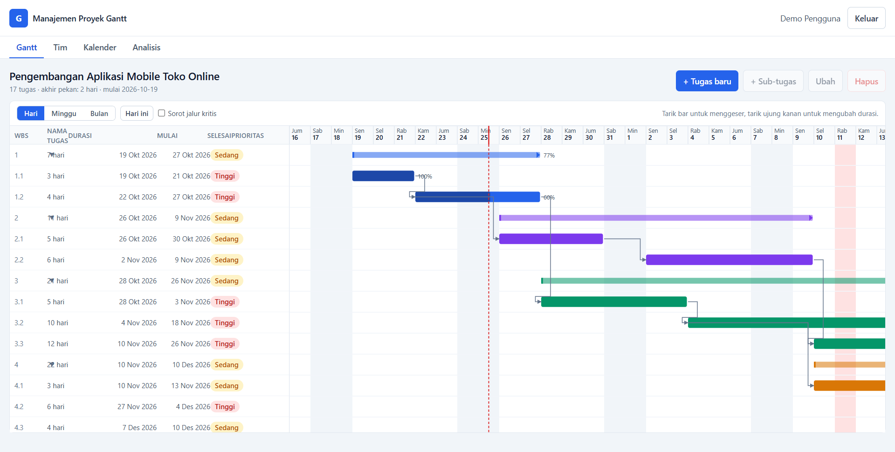
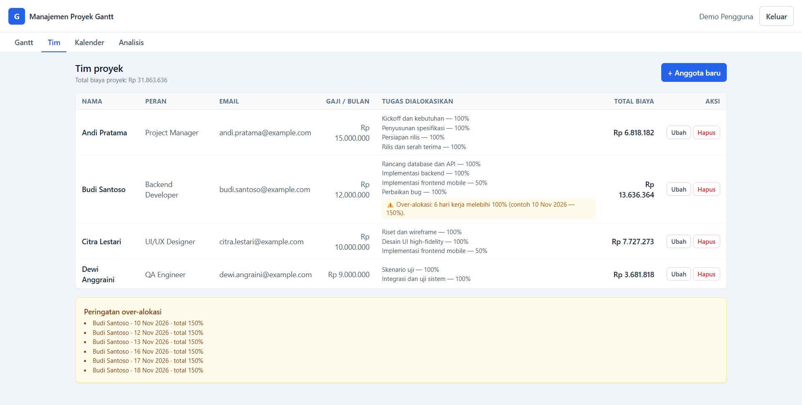

# Aplikasi Manajemen Proyek Gantt Chart

Aplikasi web manajemen proyek berbasis Gantt Chart, multi-pengguna, dengan data tersimpan di
database melalui REST API (bukan `localStorage`). Antarmuka berbahasa Indonesia.

## Tangkapan layar

**Halaman Gantt** — bar tugas bertingkat, panah dependensi, progres, penanda hari ini, dan garis jalur kritis.



**Halaman Tim** — alokasi anggota ke tugas, total biaya per anggota, dan peringatan over-alokasi.



## Daftar fitur

1. **Manajemen tugas** — tambah/ubah/hapus tugas, durasi dalam hari kerja, tanggal mulai paling
   awal, prioritas (Low/Medium/High), warna indikator, sub-tugas (parent-child maksimal 3 level,
   rentang dan progres tugas induk dihitung otomatis).
2. **Dependensi dan linimasa** — hubungan Finish-to-Start (FS) dan Start-to-Start (SS) dengan jeda
   hari kerja (lag); Gantt SVG dengan bar, panah dependensi, drag, dan resize.
3. **Manajemen sumber daya** — anggota tim (nama, email, peran, gaji) dan alokasi anggota ke tugas
   beserta persentasenya.
4. **Kalender proyek** — pengaturan hari akhir pekan dan hari libur khusus; durasi hanya menghitung
   hari kerja.
5. **Analisis proyek** — Critical Path Method (CPM) dan diagram PERT, plus biaya serta peringatan
   over-alokasi.

Di luar cakupan: kolaborasi real-time, ekspor PDF, notifikasi email, multi-bahasa, deployment cloud.

## Tech stack

| Lapisan | Teknologi |
| --- | --- |
| Frontend | React 18, TypeScript, Vite, Tailwind CSS, React Router, TanStack Query, react-hook-form, zod |
| Backend | Node.js, Express, TypeScript (tsx untuk dev), zod, jsonwebtoken, bcryptjs, helmet, cors, express-rate-limit |
| Database | SQLite dengan Prisma ORM (`server/prisma/dev.db`, tidak ikut di-commit) |
| Logika inti | Paket `shared` (TypeScript murni, dipakai server dan client) |
| Gantt dan PERT | Digambar sendiri dengan SVG tanpa library Gantt eksternal |
| Test | Vitest, Supertest, Testing Library |
| Tooling | npm workspaces, concurrently |

Struktur: `shared/src` (mesin penjadwalan, CPM, PERT, biaya, skema zod), `server` (REST API +
Prisma), `client` (antarmuka). Mesin penjadwalan dipakai bersama supaya hasil di server dan
pratinjau di client identik.

## Prasyarat

- Node.js 20 atau lebih baru
- npm 10 atau lebih baru

## Cara install

```bash
npm install                     # memasang seluruh dependensi workspace
cp server/.env.example server/.env
# isi JWT_SECRET dengan string acak, contoh:
#   node -e "console.log(require('crypto').randomBytes(32).toString('hex'))"
npm run db:migrate              # membuat skema database (server/prisma/dev.db)
npm run db:seed                 # data contoh (aman dijalankan berulang)
```

Perintah berguna lain:

```bash
npm run db:reset                # hapus dan buat ulang database + jalankan seed
npm run build                   # build shared, server, dan client
npm run typecheck               # tsc --noEmit di semua workspace
npm test                        # Vitest di semua workspace
```

## Cara menjalankan

```bash
npm run dev
```

- Aplikasi (client): **http://localhost:5173**
- REST API (server): **http://localhost:3001/api** — cek `http://localhost:3001/api/health`

Vite mem-proxy `/api` ke `http://localhost:3001`, jadi cukup membuka alamat client.

### Akun demo

| Email | Kata sandi |
| --- | --- |
| `demo@example.com` | `Demo12345` |

## Ringkasan API

Semua rute memakai prefiks `/api`. Rute selain `auth/register`, `auth/login`, dan `health`
memerlukan header `Authorization: Bearer <token>`. Setiap data dicek kepemilikannya: pengguna lain
mendapat balasan 404.

| Method dan path | Fungsi |
| --- | --- |
| `GET /health` | Cek server hidup |
| `POST /auth/register` · `POST /auth/login` | Daftar dan masuk, mengembalikan token + user |
| `GET /auth/me` | Data pengguna saat ini |
| `GET, POST /projects` | Daftar dan buat proyek |
| `GET, PATCH, DELETE /projects/:id` | Snapshot lengkap proyek, ubah, hapus |
| `POST /projects/:id/tasks` | Buat tugas (bisa dengan `parentId`) |
| `PATCH, DELETE /tasks/:id` | Ubah tugas, hapus tugas beserta anaknya |
| `POST /tasks/:id/move` | Ubah induk dan posisi tugas |
| `POST /tasks/:id/dependencies` | Tambah predecessor (`predecessorId`, `type`, `lagDays`) |
| `PATCH, DELETE /dependencies/:id` | Ubah atau hapus dependensi |
| `GET, POST /projects/:id/resources` | Daftar dan tambah anggota tim |
| `PATCH, DELETE /resources/:id` | Ubah atau hapus anggota |
| `POST /tasks/:id/assignments` · `PATCH, DELETE /assignments/:id` | Alokasi anggota ke tugas |
| `PUT /projects/:id/calendar` | Atur hari akhir pekan (jadwal dihitung ulang) |
| `POST /projects/:id/holidays` · `DELETE /holidays/:id` | Kelola hari libur khusus |
| `GET /projects/:id/analysis` | Hasil CPM, jalur kritis, data PERT, biaya, dan beban resource |

Setiap mutasi yang mengubah jadwal mengembalikan `{ "tasks": [...] }` berisi seluruh tugas terbaru.

Format error: `{ "error": { "code": "STRING", "message": "pesan bahasa Indonesia", "details": {} } }`
dengan status 400/422 (validasi), 401 (belum login), 404 (tidak ditemukan), 409 (konflik).

## Test

```bash
npm test                 # seluruh workspace: shared (32), server (51), client (20)
npm test -w shared       # mesin penjadwalan termasuk seluruh vektor uji blueprint 6.11
npm test -w server       # integrasi Supertest memakai database SQLite terpisah (server/prisma/test.db)
npm test -w client       # test komponen dan halaman: bar Gantt, panah dependensi, PERT, form tugas
```

## Asumsi

1. **Lokasi `.env`** — berkas `.env` diletakkan di `server/.env` (contoh di `server/.env.example`)
   agar Prisma CLI dan server menemukannya tanpa bergantung pada direktori kerja. Server gagal start
   dengan pesan jelas bila `JWT_SECRET` kosong.
2. **Urutan build `shared`** — skrip root `typecheck` dan `test` membangun paket `shared` lebih dulu
   karena server dan client mengimpor hasil `shared/dist`.
3. **Helper kepemilikan** — pengecekan kepemilikan data diletakkan di
   `server/src/middleware/access.ts` (tambahan kecil di luar daftar berkas blueprint).
4. **Ordinal CPM** — `project.startDate` dipakai sebagai ordinal 0 perhitungan CPM, sedangkan
   `startDate` tiap tugas tetap menjadi batas "mulai paling awal" pada penjadwalan.
5. **Respons alokasi** — alokasi anggota dan data tim tidak mengubah jadwal, sehingga responsnya
   mengembalikan objek terkait (bukan `{ tasks }`); mutasi tugas/dependensi/kalender selalu
   mengembalikan seluruh daftar tugas.
6. **Tugas induk** — kolom yang dihitung otomatis (durasi, tanggal mulai, progres, estimasi)
   bersifat read-only; server menolak perubahannya dengan 409 dan pesan jelas.
7. **Estimasi optimistis/pesimistis** hanya menambah informasi `te` dan variansi pada diagram PERT,
   tidak mengubah jadwal.
8. **Rate limit** — rute `auth/register` dan `auth/login` dibatasi 100 permintaan per 15 menit per IP.
9. **Zoom Gantt** (Hari/Minggu/Bulan) disimpan sebagai state antarmuka, tidak dipersistensi.
10. **Warna dan prioritas** divalidasi sebagai kode hex `#rrggbb` dan enum LOW/MEDIUM/HIGH.

## Catatan keamanan

- `npm audit --omit=dev` bersih dari paket runtime aplikasi. Sisa temuan berasal dari rantai CLI
  Prisma (`prisma`, `@prisma/config`, `deepmerge-ts`) dan perkakas pengembangan (`vite`, `vitest`,
  `tailwindcss`), yang hanya dipakai saat build/test dan tidak ikut berjalan di server produksi.
- `react-router-dom` sudah berada di versi yang menerima perbaikan (7.x) sehingga temuan
  open-redirect pada rilis 6.x tidak berlaku lagi.
- Rute `auth/login` dan `auth/register` dibatasi rate limit; `helmet` dan `cors` dipasang di server;
  kata sandi di-hash dengan bcryptjs dan `passwordHash` tidak pernah dikirim ke client.
